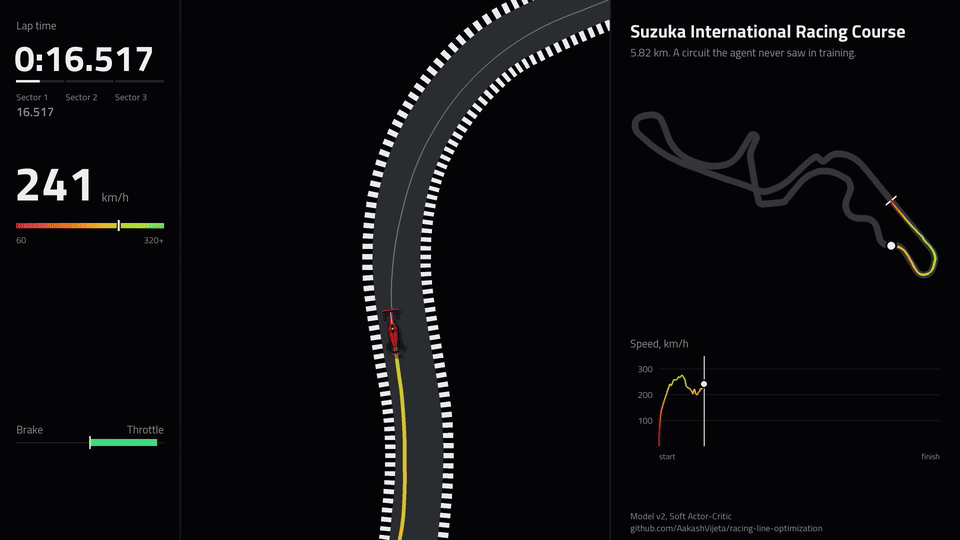

# Racing Line Optimization with Reinforcement Learning

[](LICENSE)

A Soft Actor-Critic (SAC) agent that learns to drive fast laps of Formula 1 circuits. The car runs in a custom Gymnasium environment with a simplified F1 vehicle model. The agent trains on 37 real circuits plus 400 procedurally generated tracks, and is scored on tracks it never saw in training, including Suzuka.



*The full lap in 1080p60: [suzuka_lap.mp4](https://github.com/AakashVijeta/racing-line-optimization/releases/download/models-v1/suzuka_lap.mp4)*

> **In short:** the default model, `v2`, finishes **48 of 50 generated tracks it has never seen** and laps the held-out **Suzuka in 1:27.9**. A model trained only on real circuits finishes 21 of those 50 and does not finish Suzuka.

## Contents

- [Results](#results)
- [How it works](#how-it-works)
- [Project structure](#project-structure)
- [Getting started](#getting-started)
- [Circuits](#circuits)
- [Limitations](#limitations)
- [License](#license)

## Results

Each model drives one deterministic lap from a standing start on every track (`python agent_eval.py --model <m> --procedural test`).

| Laps completed | v1 | v2 (default) | v3 |
|---|---|---|---|
| Real, training circuits (37) | 28 | 34 | 33 |
| Real, validation: Monaco, Spa (2) | 1 | 1 | 1 |
| Real, test: Suzuka (1) | 0 | 1 | 1 |
| Generated test tracks (50) | 21 | 48 | 46 |
| **Total (90)** | **50** | **84** | **81** |
| Suzuka lap | DNF | 1:27.900 | 1:24.850 |
| Spa lap | 1:34.000 | 1:40.400 | 1:36.650 |

The three models:

| Model | Training tracks | Checkpoint |
|---|---|---|
| `v1` | Real circuits only | Best model saved during its run |
| `v2` | Real circuits plus generated tracks, with domain randomization | 2.0M steps |
| `v3` | Same settings and seed as `v2` | 3.0M steps |

**Reliability.** `v1` saw only the real circuits and finishes 21 of the 50 unseen generated tracks. `v2` also trained on generated tracks with domain randomization, and finishes 48. Monaco is unfinished by all three models.

**Pace.** `v2` pays for its reliability with speed. On the laps both finish, it is slower than `v1` on every one: a median of 5.7% on real circuits (27 laps) and 5.1% on generated tracks (21 laps). `v3` recovers most of that. It is a median 4.7% faster than `v2` on real circuits and 4.3% faster on generated tracks, which puts it about 1% behind `v1`. It finishes three fewer laps than `v2`.

**Failures.** `v2` goes off track on Monaco, Jeddah, Albert Park, Mexico City and two generated tracks. `v3` goes off track on Monaco, Shanghai, the Nürburgring, Portimão and two generated tracks, and stalls on Las Vegas and two generated tracks.

Per-track times are in [`results/`](results). Suzuka and the 50 generated test tracks are the unbiased generalization results: Monaco, Spa and the generated validation tracks are used to pick the best checkpoint during training.

The simulator has no gears, tyre wear or elevation, so these lap times are for comparing models inside this simulator. They are not comparable with real F1 lap times.

### What the training runs showed

- **Training is reproducible, to the bit.** `v3` was started with the same seed and settings as `v2` on the same machine. Its reward curve, entropy coefficient and validation scores match `v2` exactly for the first 2.95M steps.
- **A checkpoint is not the whole training state.** The `v2` run was interrupted at 2.95M steps and continued from a checkpoint, which does not include the replay buffer. Over the next 600k steps it finished 9–16 of 18 validation laps, where the uninterrupted `v3` run finished 14–17. The trainer has no resume option for this reason.
- **The policy is unstable between checkpoints.** A sweep of the `v3` run on 106 tracks, one checkpoint every 100k steps, gives 99, 89, 93 and 55 laps for four consecutive checkpoints (3.1M to 3.4M). The 2.5M checkpoint finishes 11. Which checkpoint is picked matters as much as how long the run trains.
- **More training did not help.** The best checkpoint in that sweep is at 2.0M steps (100 of 106 laps), and nothing after 3.9M finishes more than 93.
- **Two real validation tracks are too few.** The 3.4M checkpoint scored 16/18 in validation but finished 7 of the 37 real training circuits. `checkpoint_sweep.py` exists to catch this.
- **Entropy can eat the reward.** SAC adds an entropy term to every step's reward. In an earlier run with the auto-tuned coefficient left uncapped, that cost grew until it cancelled the progress reward, and the policy collapsed into stalling and crashing. With the coefficient capped at 0.02, the term costs 0.01–0.03 per step against about 0.3 of driving reward.
- **A penalty the agent can postpone is a discounted penalty.** Braking to a stop before a hard corner delays the stall penalty, and a delayed penalty is worth less. The stall rule is sized so that stopping is still worse than crashing (see [Reward](#reward)). Parking is not gone: after 2M steps of the `v3` run, about 13% of training episodes still end in a stall, with spikes near 70%.

## How it works

```
circuits/*.geojson ──► track_preprocessing.py ──► tracks/*.npy ──┐
  (lon/lat lines)       project · spline ·        (centerline    ├──► RacingEnv ──► SAC agent
                        adaptive resample          in metres)    │    (racing_env.py,  (sac_train.py)
track_generator.py ──► random control polygons, same pipeline ───┘     car.py)
```

### 1. Track preprocessing (`track_preprocessing.py`)

- Loads the `LineString` centerline from each GeoJSON file and projects longitude and latitude to local metres (equirectangular, around the first point).
- Removes duplicate points, including the repeated closing point, which would otherwise add a zero-length segment and a false curvature spike at the start line.
- Fits a centripetal Catmull-Rom spline through the points. The source points are roughly 20 m apart, so a plain polyline would have zero curvature along each segment and a kink at every vertex.
- Resamples by curvature. Point density is `1 + 3 × normalized curvature`, with curvature smoothed over 20 m around the loop. Straights get 5 m between points and the tightest corner of each track gets 1.25 m. The 40 circuits end up with 926 to 1,645 points each.
- Caches each result in `tracks/<id>.npy`. `tracks/manifest.json` records the preprocessing version and spacing, and `prepare_tracks()` rebuilds any track that is missing or out of date.

### 2. Vehicle model (`car.py`)

| Parameter | Value | Notes |
|---|---|---|
| Wheelbase | 3.5 m | Kinematic bicycle model |
| Base grip | 44.1 m/s² (about 4.5 g) | Mechanical grip |
| Downforce | `+ 0.005 v²` m/s² | About 7 g in total at 250 km/h |
| Drag | `0.0022 v²` m/s² | Top speed about 340 km/h |
| Throttle / brake | +20 / −40 m/s² | Mapped from the action |
| Steering | ±0.4 rad | Mapped from the action |

At each step the combined longitudinal and lateral acceleration demand is capped to a traction circle whose radius grows with speed. The steering angle the car achieves is worked back from the lateral acceleration left after that cap. The simulation runs at 20 Hz (`dt = 0.05 s`).

### 3. Environment (`racing_env.py`)

A `gymnasium.Env` that picks a track from its pool at every `reset()`, uniformly or by weight (`set_track_weights`). Pass `options={"track": id}` to choose one.

**Observation** (68 values in the current layout):

| Values | Contents |
|---|---|
| 3 | Speed, lateral offset from the centerline, heading error |
| 3 | Track width, previous steering, previous throttle |
| 60 | 20 lookahead points, 10 m apart (200 m ahead): distance, relative angle, signed curvature |
| 2 | Distance to the left and right track edges |

Lookahead points are interpolated along the centerline, and edge distances are measured to the nearest boundary segment. The environment still supports two older layouts through `obs_version`: version 2 (65 values, no width or previous action, unsigned curvature) is what `v1` uses, and version 1 is an earlier vertex-based variant. `v2` and `v3` use version 3.

**Action:** `[steering, throttle]`, each in `[-1, 1]`. Negative throttle brakes.

#### Reward

All terms are per metre, so the scale is the same on short and long tracks.

| Event | Reward |
|---|---|
| Progress along the centerline | +0.1 per metre |
| Time | −0.03 per step, which breaks even at 6 m/s |
| Steering change between steps | −0.045 × the change in the steering action |
| Off track, or driving backwards | −45, episode ends |
| Stalled | −75, episode ends |
| Lap completed | +10, episode ends |

The car counts as stalled when it is under 2 m/s for 0.25 s (after a 3 s grace period from the start), or makes under 5 m of progress in 10 s. The stall penalty has to beat a crash even after the longest delay the agent can buy by braking: from about 90 m/s that is 2.3 s, and −75 × 0.995⁵⁰ ≈ −58, which is still below −45.

An episode is also cut off once it has run 10 s longer than a lap at 12 m/s would take.

#### Domain randomization

With `randomize=True` (training only), each episode:

- scales the track width by 0.7–1.2×, clamped to 8–16 m;
- reverses the direction of travel and mirrors the track, each with probability 0.5;
- starts at a random point on the lap, up to 30% of the half-width off the centerline, with up to 0.1 rad of heading error, at up to 80% of the speed the next 150 m of corners allows.

With a random start, a lap is one full track length of progress. Evaluation always uses the standing start at the start line.

The nearest centerline point is searched within ±30 points of the previous one. That stops the car's position from jumping across a crossover such as the one at Suzuka.

### 4. Procedural tracks (`track_generator.py`)

A track starts as a random control polygon: a noisy, stretched loop of 18–32 points, with some points split into close pairs to make hairpins and chicanes. It then goes through the same spline and resampling as the real circuits. A candidate is rejected if it:

- is shorter than 3 km or longer than 7 km;
- crosses itself;
- has a corner tighter than 9 m radius;
- brings two separate parts of the track within 20 m of each other.

Each track gets a width between 8 and 16 m. There are three fixed pools, set by seed in `config.py`: 400 training tracks, 16 validation tracks and 50 test tracks. The test pool is never used for training or checkpoint selection.

### 5. Training (`sac_train.py`)

- **Algorithm:** Stable-Baselines3 SAC with an MLP policy of `[512, 512, 256]` hidden units, on 8 parallel environments.
- **Hyperparameters:** discount 0.995, batch size 512, replay buffer of 2M transitions, 10k warm-up steps, 2 gradient steps per vectorized step.
- **Learning rate:** linear decay from 3e-4 to 3e-5 over the run.
- **Entropy:** auto-tuned from 0.02 with a target entropy of −4 and a hard cap of 0.02. Training stops early if the coefficient passes 0.35, which can only happen with the cap disabled.
- **Training mix:** half the episodes on the 37 real training circuits and half on the 400 generated tracks, with domain randomization.
- **Adaptive sampling:** each real circuit is sampled in proportion to 0.5 plus its recent failure rate, so hard circuits get more practice.
- **Model selection:** every 100k steps the policy drives one lap on each of the 18 validation tracks (Monaco, Spa and 16 generated). A finished lap scores 1 + average speed / 100 m/s, and an unfinished lap scores the fraction covered. The best mean score is saved to `best_model/`, and every score is appended to `validation_history.csv`.
- **Checkpoints:** every 50k steps, in `models/<run>/checkpoints/`.
- **Logging:** TensorBoard gets lap-completion rate and mean progress separately for real and generated tracks, and the share of episodes ending in each termination reason. These say more than the mean episode reward, which mostly reflects track length.
- **Run record:** each run writes `models/<run>/train_config.json` with its settings and the git commit it was trained from. The script refuses to start if the run directory already exists.

On an Apple M5 laptop this runs at about 380 steps per second, so the default 8M steps take roughly 6 hours.

## Project structure

```
.
├── config.py                 # Track IDs, widths, train/val/test split, model registry
├── car.py                    # Vehicle model
├── racing_env.py             # Gymnasium environment and the shared lap-driving helper
├── track_preprocessing.py    # GeoJSON → metric centerline, curvature
├── track_generator.py        # Procedural tracks and the fixed train/val/test pools
├── plot_track.py             # Geometry helpers: track boundaries, test oval
├── sac_train.py              # SAC training
├── agent_eval.py             # Time trial on every track → results CSV
├── checkpoint_sweep.py       # Time-trial and rank the checkpoints of a run
├── sac_eval.py               # Watch the agent on random tracks
├── watch_agent.py            # Watch the agent on one track, with live telemetry
├── record_lap.py             # Record one lap to an .npz file
├── lap_render.py             # Lap video renderer
├── f1_car.py                 # Top-down car sprite for the renderer
├── replay.py                 # Interactive replay of a recorded lap
├── export_video.py           # Render a recorded lap to MP4, GIF and a poster PNG
├── assets/                   # README media and the Titillium Web font
├── circuits/                 # Source GeoJSON circuit layouts (40)
├── tracks/                   # Preprocessed centerlines (cache)
├── results/                  # Time-trial results per model
└── tests/                    # pytest suite
```

## Getting started

### Requirements

- Python 3.12 or newer. The project is developed on Python 3.14 on macOS and has also been tested on Python 3.12 on Linux.
- A display, for the pygame viewers. Training, time trials and video export run headless.

### Installation

```bash
git clone https://github.com/AakashVijeta/racing-line-optimization.git
cd racing-line-optimization
python -m venv .venv && source .venv/bin/activate
pip install -r requirements.txt
```

`requirements-lock.txt` has the exact versions the models were trained with.

### Models

Trained weights are not included in the repository, so train a model before running the evaluation scripts.

Every script that loads a model takes `--model`, which is either a key from `MODEL_PATHS` in `config.py` or the path to a `.zip` file. Without it, the scripts load `DEFAULT_MODEL_VERSION`, which is `v2` and expects `models/sac_v2/best_model/best_model.zip`.

To refer to a new model by name, add it to `MODEL_PATHS` and `OBS_VERSIONS` in `config.py`. For a `.zip` path the observation layout is inferred from the model's input size, and `--obs-version` overrides it.

### Train

```bash
python sac_train.py --run sac_v4
python sac_train.py --run sac_v4 --proc-frac 0.7 --timesteps 10000000
tensorboard --logdir tb_logs
```

| Option | Default | Meaning |
|---|---|---|
| `--run` | required | Run name; outputs go to `models/<run>/` |
| `--timesteps` | 8,000,000 | Total environment steps |
| `--n-envs` | 8 | Parallel environments |
| `--seed` | 0 | Random seed |
| `--proc-frac` | 0.5 | Share of episodes on generated tracks; 0 trains on real circuits only |
| `--proc-train` | 400 | Number of generated training tracks |
| `--no-randomize` | off | Disable domain randomization |
| `--no-adaptive` | off | Sample real circuits uniformly |
| `--lr`, `--lr-final` | 3e-4, 3e-5 | Learning rate at the start and end |
| `--gradient-steps` | 2 | Gradient steps per vectorized step |
| `--eval-freq` | 100,000 | Steps between validation runs |
| `--target-entropy` | −4 | SAC entropy target |
| `--max-ent-coef` | 0.02 | Cap on the entropy coefficient; 0 disables it |
| `--warm-start` | none | Model whose policy weights initialise training |

A run takes hours and cannot be resumed, so start it in a way that survives closing the terminal:

```bash
nohup python -u sac_train.py --run sac_v4 > logs/sac_v4.log 2>&1 &
```

### Evaluate

```bash
python agent_eval.py                          # default model on the 40 circuits → results/v2.csv
python agent_eval.py --procedural test        # ...plus the 50 generated test tracks
python agent_eval.py --model models/sac_v4/best_model/best_model.zip --procedural test
python watch_agent.py --track mc-1929         # watch one track (default: Suzuka)
python sac_eval.py                            # watch laps on random tracks
```

`agent_eval.py` prints a leaderboard and writes it to `results/<model>.csv`, or to the path given with `--out`.

### Pick a checkpoint

```bash
python checkpoint_sweep.py --run sac_v4
python checkpoint_sweep.py --run sac_v4 --start 2000000 --every 100000 --proc-test --workers 8
```

The sweep time-trials checkpoints of a run (every 250k steps from 2M by default) plus its best and final models, on the 40 real circuits and the 16 generated validation tracks. It ranks them by laps completed on the training and validation tracks, then by mean lap time on the tracks every contender finished. A contender is a candidate within 10% of the most laps. Suzuka and the generated test tracks (`--proc-test`) are reported but never used for ranking. Results go to `models/<run>/checkpoint_sweep.csv`.

### Record, replay and export a lap

```bash
python record_lap.py                          # Suzuka with the default model → suzuka_lap.npz
python record_lap.py --track be-1925 --out spa_lap.npz
python replay.py spa_lap.npz                  # SPACE pause, ←/→ seek 1 s (SHIFT: 5 s), R restart, ESC quit
python export_video.py spa_lap.npz            # assets/spa_lap.mp4, .gif and .png
```

`record_lap.py` saves nothing if the agent does not finish the lap.

The video shows a top-down chase camera, on black, of the track with white edge blocks and the racing line coloured by speed (red when slow, green flat out). Beside it are the lap time and sector times, the speed on its colour scale, a brake and throttle bar, the circuit map and a speed graph. Frames are drawn at twice the output size and scaled down for anti-aliasing, then piped into ffmpeg. The GIF is cut from the MP4, by default from the 10 seconds with the most cornering. `export_video.py` takes `--width`, `--height`, `--fps`, `--gif-start`, `--gif-length`, `--gif-width` and `--skip-mp4`, among others.

### Tests

```bash
pytest
```

## Circuits

| ID | Circuit | Width (m) | Length (km) | Split |
|---|---|---|---|---|
| `ae-2009` | Yas Marina Circuit | 14 | 5.30 | train |
| `ar-1952` | Autódromo Oscar y Juan Gálvez | 12 | 4.31 | train |
| `at-1969` | Red Bull Ring | 12 | 4.31 | train |
| `au-1953` | Albert Park Circuit | 12 | 5.28 | train |
| `az-2016` | Baku City Circuit | 10 | 5.96 | train |
| `be-1925` | Circuit de Spa-Francorchamps | 14 | 6.99 | val |
| `bh-2002` | Bahrain International Circuit | 15 | 5.43 | train |
| `br-1940` | Autódromo José Carlos Pace - Interlagos | 12 | 4.31 | train |
| `br-1977` | Autódromo Internacional Nelson Piquet | 12 | 4.98 | train |
| `ca-1978` | Circuit Gilles-Villeneuve | 12 | 4.37 | train |
| `cn-2004` | Shanghai International Circuit | 15 | 5.46 | train |
| `de-1927` | Nürburgring | 13 | 5.15 | train |
| `de-1932` | Hockenheimring | 13 | 4.56 | train |
| `es-1991` | Circuit de Barcelona-Catalunya | 14 | 4.67 | train |
| `es-2026` | Circuito de Madring | 12 | 5.45 | train |
| `fr-1960` | Circuit de Nevers Magny-Cours | 11.5 | 4.47 | train |
| `fr-1969` | Circuit Paul Ricard | 15 | 5.83 | train |
| `gb-1948` | Silverstone Circuit | 15 | 5.89 | train |
| `hu-1986` | Hungaroring | 11 | 4.38 | train |
| `it-1914` | Autodromo Internazionale del Mugello | 13 | 5.25 | train |
| `it-1922` | Autodromo Nazionale Monza | 14 | 5.79 | train |
| `it-1953` | Autodromo Enzo e Dino Ferrari | 11 | 4.91 | train |
| `jp-1962` | Suzuka International Racing Course | 12 | 5.82 | test |
| `mc-1929` | Circuit de Monaco | 8.5 | 3.33 | val |
| `mx-1962` | Autódromo Hermanos Rodríguez | 12 | 4.31 | train |
| `my-1999` | Sepang International Circuit | 15 | 5.56 | train |
| `nl-1948` | Circuit Zandvoort | 10 | 4.27 | train |
| `pt-1972` | Autódromo do Estoril | 11 | 4.18 | train |
| `pt-2008` | Autódromo Internacional do Algarve | 14 | 4.66 | train |
| `qa-2004` | Losail International Circuit | 14 | 5.43 | train |
| `ru-2014` | Sochi Autodrom | 14 | 5.85 | train |
| `sa-2021` | Jeddah Corniche Circuit | 11 | 6.21 | train |
| `sg-2008` | Marina Bay Street Circuit | 11 | 4.95 | train |
| `tr-2005` | Intercity Istanbul Park | 14 | 5.32 | train |
| `us-1909` | Indianapolis Motor Speedway | 14 | 4.09 | train |
| `us-1956` | Watkins Glen International | 12 | 5.46 | train |
| `us-2012` | Circuit of the Americas | 15 | 5.53 | train |
| `us-2022` | Miami International Autodrome | 12 | 5.43 | train |
| `us-2023` | Las Vegas Street Circuit | 12 | 6.24 | train |
| `za-1961` | Kyalami Grand Prix Circuit | 12 | 4.53 | train |

Circuit layouts are from [bacinger/f1-circuits](https://github.com/bacinger/f1-circuits) by Tomislav Bacinger, used under the MIT licence ([`circuits/LICENSE.md`](circuits/LICENSE.md)). Lengths are measured along the preprocessed centerline. Widths are set per circuit in `config.TRACK_WIDTHS`.

### Adding a circuit

1. Add `circuits/<id>.geojson` containing a single `LineString` feature.
2. Add `<id>` to `TRACK_IDS` in `config.py`, and optionally its width to `TRACK_WIDTHS` (the default is 15 m).
3. Run `python track_preprocessing.py <id>`. Any other script also builds `tracks/<id>.npy` the first time the track is used.

A new circuit joins the training set unless it is listed in `VAL_TRACKS` or `TEST_TRACKS`.

## Limitations

- The car is a 2D kinematic bicycle with no tyre slip, weight transfer, gears or elevation, and it is treated as a point when checking track limits.
- Monaco is not finished by any model.
- Training is unstable from one checkpoint to the next, and no model so far has both `v3`'s pace and `v2`'s reliability.
- Trained weights are not published.

Possible next steps are stabilising training, comparing the agent against a minimum-curvature racing line, and a dynamic tyre model.

## License

MIT, see [`LICENSE`](LICENSE). The circuit data has its own MIT licence, and the bundled Titillium Web font is under the SIL Open Font License ([`assets/fonts/OFL.txt`](assets/fonts/OFL.txt)).
